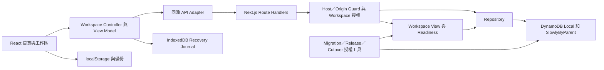

# slowly. Phase 5 最終完成報告

2026-11-25 完成 Phase 5-E 簽核。隔離環境的 CRUD、資料一致性、故障回復與 Next.js 重啟驗收均通過。正式首頁沿用既有資料來源契約，正式 API 寫入維持關閉。

## 系統架構



完整 API 清單、資料模型、資料流程圖與備份復原步驟見 [Phase 5-E 交付手冊](phase5e-delivery.md)。互動架構圖位於本機的 `floorplan/index.html`。

## Phase 1～5 成果

| 階段 | 成果 |
| --- | --- |
| Phase 1 | Next.js／React 本機看板，支援任務、看板、日曆、子任務、備註及小組件，以 localStorage 保存。 |
| Phase 2 | 建立伺服器端 Repository、實體模型、DynamoDB Local 存取與父層索引。見 [資料層文件](phase2-data-layer.md)。 |
| Phase 3 | 建立同源 Route Handlers、DTO、scope 檢查與 HTTP 錯誤契約。見 [API 文件](phase3-api.md)。 |
| Phase 4 | 完成 verified backup、Migration／Receipt、Release、Trusted Evidence、分段 Cutover 授權與正式唯讀驗收。見 [Phase 4 結案](phase4-final-report.md)。 |
| Phase 5 | 完成隔離 Workspace、Board、Task、Widget CRUD，React 三種子資源寫入、拖曳排序、資料來源切換、Reload、Recovery 和伺服器重啟驗收。 |

## CRUD、授權與資料安全

- Workspace View 提供整個工作區的 DTO。Repository 以字串 `id` 為主鍵、`SlowlyByParent` 查找子項，並用強一致讀取、父版本與計數核對投影。
- Workspace、Board、Task、Widget 使用既有 CRUD API。Board、Task、Widget 支援同父層排序。隔離寫入先驗證 Workspace 歸屬、grant、Session、Release 與遷移鎖，再以條件式交易更新業務項目、父層版本、計數與 Receipt。
- UUID v4 `Idempotency-Key` 綁定操作範圍與請求指紋。同鍵相同內容回放原結果，內容變更拒絕。UNKNOWN 先查 Receipt，確認後重新讀取 Workspace View。查不到或不一致時保留 Journal 及原操作資訊。
- Migration 並行誤報的根因為父項與父 Receipt 來自不同交易快照。修正以 `TransactGet` 同時讀取兩者，維持雜湊、ownership、版本與條件式寫入驗證。見 [根因及追蹤](phase5e-migration-concurrency.md)。

## 驗收證據

| 項目 | 結果 |
| --- | --- |
| Node、React、API | 238/238，無略過。 |
| Migration 並行 | 自然並行 10/10 輪、受控交錯 10/10 輪。每輪 14 案，合計 280/280，隔離表已清理。 |
| Phase 4 隔離回歸 | Controlled UI 6/6、Release 13/13、Main UI／Safe Create 19/19、Trusted Evidence 8/8。 |
| Phase 5 回歸 | B1 隔離套件通過，B2 至 C4、D1 至 D4 和 E 的 HTTP／Chrome 驗收 31/31 組。 |
| Chrome E2E 與持久性 | 使用臨時 Chrome 設定檔、實際 Next.js HTTP 與隔離 DynamoDB Local。兩個 Workspace、三次重新載入、40 筆 Receipt 均通過。重啟 Next.js 後，兩個 Workspace 的資料、排序、版本與關聯一致。 |
| 品質 | Build、修改檔案 ESLint 與 git diff --check 通過。完整 ESLint 仍有 workspace-board.js 的 3 項既有錯誤。 |
| 最終唯讀複核 | 正式表與索引均為 ACTIVE。35 筆指紋與回歸快照一致，資料庫無 Pending／UNKNOWN。隔離表清理備份與清單吻合，原有 7 筆隔離資料已清為 0。沒有其他 Slowly_Phase 驗收表。 |

**原始 Chrome 人工驗收為 USER_CONFIRMED。** 使用者確認原始首頁與各類資料正常、無草稿、IndexedDB operations 無 active／Pending／UNKNOWN、Recovery Journal 無未完成紀錄，localStorage 與 verified backup 一致，且正式資料與原始備份未被修改。本輪使用既有測試紀錄作交叉核對，未操作使用者 Chrome 或重跑正式切換。

## 技術債與正式部署前工作

- `workspace-board.js` 有兩處 effect 同步更新 state 與一處首頁連結的 ESLint 問題，已保留原規則與結果。部署審查需接受或修正這三項。
- Workspace 管理透過 HTTP 驗收，首頁尚無 Workspace CRUD 表單。尚未實作 Task 跨 Board 移動。持久性測試涵蓋 Next.js 重啟，DynamoDB Local 行程或主機重啟恢復未驗收。
- 部署前須獨立查驗目標環境與身分授權、表和索引、交易讀取權限、秘密管理、備份與回復。部署當次應重新確認來源及瀏覽器狀態，完成目標環境的安全與 E2E 驗收。
- 若日後需要正式寫入、Cutover、遷移、Release 或資料修復，依各自流程取得明確授權。Phase 5 的結案旗標代表本輪驗收完成，不授權這些操作。

## 最終旗標

```yaml
PHASE4_REGRESSION_PASSED: true
CHROME_MANUAL_ACCEPTANCE: USER_CONFIRMED
ISOLATED_TEST_DATA_CLEANED: true
PHASE5_E_COMPLETE: true
PHASE5_READY: true
PRODUCTION_API_WRITE_ENABLED: false
FORMAL_CUTOVER_EXECUTED_THIS_ROUND: false
```

本輪僅更新文件並作唯讀檢查，未開始部署，也未執行 Git Commit、Push 或 Merge。
