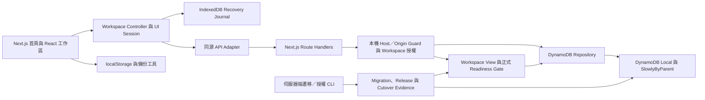
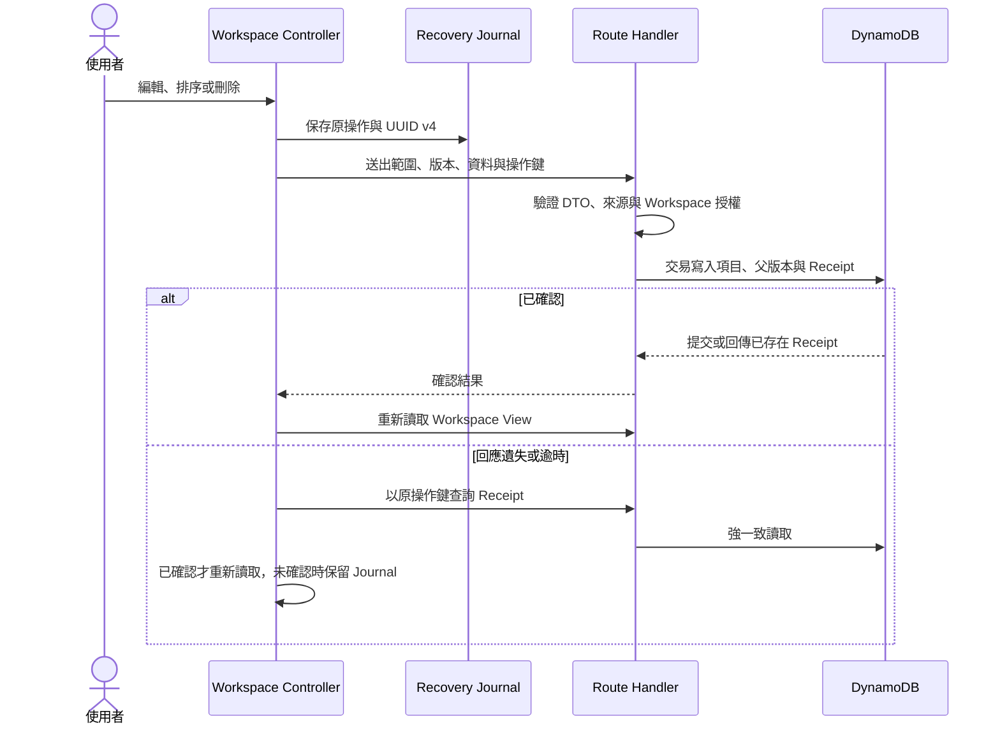

# slowly. Phase 5-E 交付手冊

Phase 5 的寫入驗收使用隔離 DynamoDB Local。正式來源仍維持 Phase 4 的既有授權邊界。首頁預設 localStorage，正式 API 寫入關閉。

## 系統架構



前端入口為 `src/app/page.js`、`main-ui.js` 和 `workspace-board.js`。 `main-workspace-controller.mjs` 管理資料來源、請求代次、回復和待處理寫入。 `main-view-model.mjs` 投影後端 DTO，保留後端 ID 與版本映射。 `slowly-api.mjs` 負責同源 HTTP、AbortSignal 和錯誤解析。伺服器以 `src/lib/api/local-routes.mjs`、`handlers.mjs`、`workspace-view.mjs` 接合 `slowly-repository.mjs`。

## 資料流



Workspace View 以 GSI 找候選項目、用強一致讀取取得內容，並重查父層版本與計數。來源切換取消可取消的讀取，並用請求代次拒絕遲到的回應。API 讀取失敗保留上次成功的畫面。版本衝突重新取得最新資料，使用者先比對草稿再決定如何重做。

## HTTP Endpoint

以下列出 Route Handler 註冊的方法，實際回應受環境、授權及 scope 限制。

| 路徑 | 方法與用途 |
| --- | --- |
| `/api/workspaces` | GET 查詢，POST 建立 |
| `/api/workspaces/{id}` | GET 讀取，PATCH 設定，DELETE 空 Workspace |
| `/api/workspaces/{id}/view` | GET 完整工作區投影與 Readiness |
| `/api/boards`、`/api/tasks`、`/api/widgets` | GET 清單，POST 建立 |
| 上述三種資源的 `/{id}` | GET 讀取，PATCH 更新，DELETE 刪除 |
| 上述三種資源的 `/order` | PATCH 同一父層內的排序 |
| `/api/operations/{operationId}` | GET 範圍相符的操作 Receipt |
| `/api/migrations`、`/api/migrations/preview` | POST 建立遷移、預覽 |
| `/api/migrations/{migrationId}` | GET Session |
| 遷移 Session 的 `/operations` 與 `/operations/{operationId}` | GET 清單或單筆，PUT 單筆執行 |
| 遷移 Session 的 `/verify`、`/release-preview`、`/release`、`/rollback-preview`、`/rollback` | POST 驗證、預覽及受控操作 |

## DynamoDB 與交易

- 表以 `id` 為主鍵，業務項目前綴為 `SLOWLY#WORKSPACE#`、`SLOWLY#BOARD#`、`SLOWLY#TASK#`、`SLOWLY#WIDGET#`。子資料保存 `parentId`、`workspaceId`，Task 和 Widget 另有 `boardId`。
- `SlowlyByParent` 以 `gsi1pk` 表示父層，`gsi1sk` 結合類型、補零後的位置及 ID。主表保存 `version`、`schemaVersion`、`position` 和各類別的 `data`。Workspace 保存 `boardCount`，Board 保存 `taskCount`、`widgetCount`、`doingCount`。
- Repository 使用條件式 `TransactWrite` 維護項目、父層計數與版本、授權或遷移鎖檢查及 Receipt。同一交易提交結果和 `SLOWLY#CRUD_OPERATION#` 記錄。相同 Key 與指紋回放原結果，改變請求內容會衝突。刪除 Receipt 保留確認狀態，結果為 null。
- 受授權的完整排序需要每個子項的版本，並檢查成員、範圍、位置及交易上限。非空 Workspace、非空 Board 會拒絕刪除。Task 完成時間由伺服器依狀態更新。

## 授權與來源

本機 Guard 核對 Host、Origin、Port 及 loopback。隔離寫入需要專用測試表、Workspace grant、未過期狀態、相符的版本、Session、Release 與資料歸屬。建立的測試 Workspace 只有在 grant 明確允許子資源寫入且 lineage 相符時才能使用該 grant。React 的寫入確認仍由伺服器覆核。

正式唯讀 View 另使用 Workspace／Plan／Namespace 設定與 Trusted Evidence。正式 Cutover 授權由伺服器端 CLI 走 Request、Approve、Redeem 與 execution evidence 驗證，屬於不同操作。隔離 fixture、瀏覽器切換確認及唯讀 Cutover 授權都不提供正式 CRUD 權限。參見 [授權契約](phase4d4f-cutover-authorization.md) 和 [回復邊界](phase4d4e-cutover-contract-recovery.md)。

首頁預設從 localStorage 載入。進入 API 模式應明確確認 Workspace，並遵守 Readiness。寫入中、草稿未處理或有 UNKNOWN 時保持既有保護。API 模式不匯入或回填本機鍵，重新整理首頁會依既有契約回到 localStorage，隔離寫入授權需再次確認。

## 備份與回復 Runbook

1. 切換前，在原始瀏覽器確認工作區、未儲存草稿與 Recovery Journal。停止新增寫入後，透過內建備份工具匯出，核對 Payload SHA-256、來源政策與 Plan ID，保留原始檔。參見 [備份與隔離預覽](phase4d1-backup-dry-run.md)。
2. 若寫入逾時或結果遺失，保留原瀏覽器設定檔、Journal、操作 Key、Workspace／Board 範圍與診斷資訊。先查 Receipt。若已確認，重新讀取 Workspace View。若查不到或內容不符，繼續保留 UNKNOWN。依法使用既有的重送流程時，只能沿用原 Key、範圍和相同 Payload。
3. 遇到版本衝突，保留草稿並重新讀取後比對差異。遇到資料不一致，暫停新寫入。保留 DynamoDB、備份與本機來源各自的現況，先在隔離環境確認恢復方式。
4. 回到 localStorage 是切換顯示來源。正式 DynamoDB 的遷移回滾或資料修復需要獨立授權與既有程序。

## 正式部署前人工確認

- 核對部署目標、資料表、Index、Workspace／Plan／Namespace、原始備份與恢復能力。
- 再次確認原始 Chrome 的來源凍結、Pending、UNKNOWN、IndexedDB 與草稿狀態。
- 任何正式 Request、Approve、Redeem、唯讀 Cutover、寫入啟用或資料修復，依各自契約取得明確授權。若要對外部署，另行審查身分驗證、權限、服務與秘密管理，並在部署目標執行驗收。
- 先處理既有 lint 問題，或由交付審查明確接受目前基線。

## 限制

- 生命週期測試使用 Chrome 發送 Workspace 管理 HTTP 請求，首頁尚未提供 Workspace CRUD 編輯畫面。Board、Task、Widget 的既有 UI 由 Chrome 案例驗收。
- 任務跨 Board 移動未有對應交易 API。伺服器重啟只重啟隔離 Next.js，DynamoDB Local 持續運作。本次未測 DynamoDB 行程或機器重啟與其磁碟恢復。
- 真實使用者 Chrome、正式備份與正式 Workspace 沿用既有驗收成果。本輪未用這些資料進行寫入或切換。

## 實測結果

| 項目 | 結果 |
| --- | --- |
| 全部 Node、React 與 API 測試檔 | 最終稽核重新執行，238/238，無略過。 |
| HTTP 與 Chrome | 31/31 組。Chrome 158.0.8127.38 實測兩個 Workspace、各兩個 Board、Task、Widget，三次重新載入，40 筆成功寫入皆有匹配 Receipt。跨 Workspace 的拒絕請求沒有留下 Receipt。 |
| Next.js 重啟 | 停止測試程序後，健康檢查無法連線。以新程序在同一隔離表重啟。兩個 Workspace 的原始 DynamoDB 記錄、Workspace View 的資料、位置、版本與關聯一致。Chrome 重新進入後顯示持久化資料。 |
| B1 與 Phase 4 隔離整合 | B1、Controlled UI、Release、Main UI／Safe Create、Trusted Evidence 通過。包含既有逾時、回應遺失、UNKNOWN、Receipt、冪等、409、Migration Lock、WIP、來源隔離與授權拒絕測試。 |
| Phase 4 遷移並行穩定性 | 修正前受控重現的根因為父 Board 與父 Receipt 讀自不同交易快照。改用 `TransactGet` 同時讀取，保留原完整性與條件式寫入檢查。稽核核對正常並行 10/10 輪、受控交錯 10/10 輪，每輪 14 案，共 280/280，且全部測試表清理。見 [遷移並行根因與追蹤](phase5e-migration-concurrency.md)。 |
| Build 與 ESLint | Build 與 `git diff --check` 通過。完整 ESLint 的三項既有錯誤在 `workspace-board.js`，包含兩處 effect 同步更新 state 及首頁連結規則。修改的腳本 ESLint 通過，新增錯誤 0。 |

Phase 4 隔離整合紀錄為 Controlled UI 6/6、Release 13/13、Main UI／Safe Create 19/19、Trusted Evidence 8/8。B1 另行重跑通過並清理。本次重新執行 Build、完整測試檔、B1、ESLint 與 diff 檢查。HTTP／Chrome 31 組和 280 個遷移案例使用修正後的既有執行紀錄，逐項核對結果與清理狀態。

## 最終安全稽核

- 正式 `SlowlyTasks` 與 `SlowlyByParent` 均為 ACTIVE。35 筆項目的內容指紋與修正後回歸的正式表快照一致，未發現資料庫端 Pending 或 UNKNOWN 控制紀錄。DynamoDB 交易採原子提交，驗收紀錄沒有未確認或部分提交的測試寫入。
- 正式 Workspace View 的 `formalRuntimeWritesEnabled` 維持 false。本輪未執行正式 Migration、Release、Cutover 或授權核發，未寫入正式資料或修改原始備份及使用者 Chrome 儲存。原始備份未重新讀取驗證。使用者 Chrome 的 Pending、UNKNOWN 與 Recovery Journal 未重新查驗。
- 早期隔離表 `Slowly_Phase4B2_29e6a829aa864fa98906b0af3718411b` 的 7 筆資料已完成清理。已用舊報告、fixture 控制記錄及正式表的唯讀對照核對歸屬。3 個 Workspace、3 個 Board 和 1 個測試控制記錄已先備份並驗證內容雜湊，再用一筆條件式交易刪除。強一致讀取確認筆數由 7 降為 0，表仍為 ACTIVE，正式表指紋一致。清理清單、備份與驗證紀錄存於 `.phase4b2-test-runs/` 下該次執行的 `item-cleanup-76284bbf-a33d-4784-833e-e02b21125fbf` 檔案組。Controlled UI 6/6 通過，實際空表也驗證缺少 fixture proof 時會拒絕授權。

## 最終人工簽核

- **USER_CONFIRMED（2026-11-25）**。使用者親自在原始 Chrome 確認首頁及 Workspace、Board、Task、Widget 顯示正常，沒有未儲存草稿，IndexedDB operations 無 active、Pending 或 UNKNOWN，Recovery Journal 無未完成紀錄。使用者確認原始 localStorage 與 verified backup 一致，正式資料和原始備份未修改。此紀錄來自使用者人工驗收。
- **唯讀複核**。正式 `SlowlyTasks` 和 `SlowlyByParent` 均為 ACTIVE，35 筆資料的逐筆指紋與修正後的驗收快照相符，資料庫端無 Pending 或 UNKNOWN。清理前備份與清單的 7 筆 ID、內容雜湊及清理驗證紀錄相符。舊隔離表仍為 ACTIVE、0 筆，沒有其他 `Slowly_Phase*` 驗收表。
- **結案判定**。Phase 4 回歸、Phase 5-B 至 E 的隔離驗收與人工簽核均通過。完整 ESLint 的 3 項既有錯誤保留為技術債。正式 API 寫入維持關閉，本輪未執行 Cutover、Migration 或 Release。

最終旗標為 `PHASE5_E_COMPLETE: true` 與 `PHASE5_READY: true`。適用範圍與部署前條件見 [Phase 5 最終完成報告](phase5-final-completion-report.md)。

## 重跑隔離驗收

```powershell
node --conditions=react-server scripts/phase5b1-task-create.mjs
node --conditions=react-server scripts/phase5b2-task-http.mjs --task-mutations --boards --widgets --workspaces --browser-write --browser-lifecycle --restart-server
```
